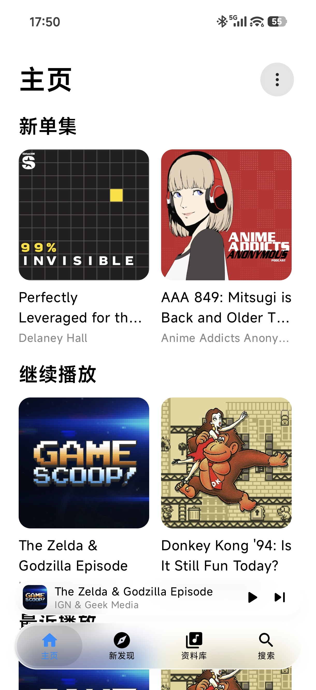
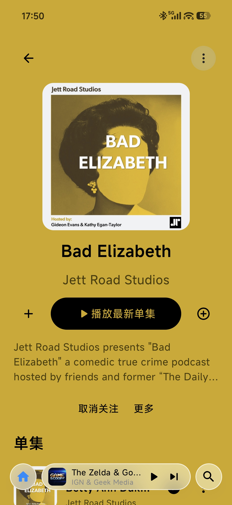
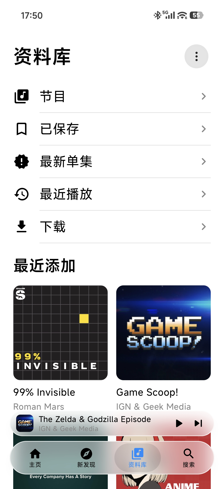
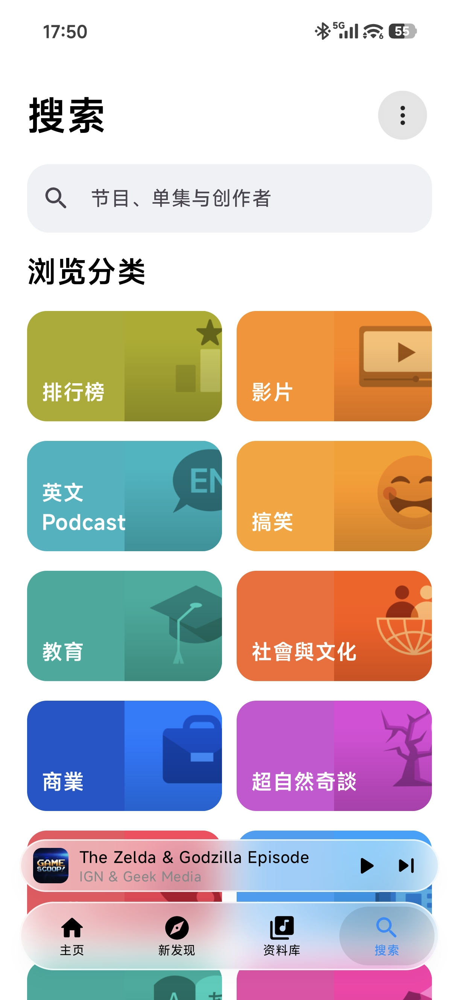

# Castflow / 听见

Castflow（中文名「听见」）是一个原生 Android 播客客户端，使用 Kotlin、Jetpack Compose 和
AndroidX Media3 开发。界面支持中文和英文。

Castflow is a native Android podcast client built with Kotlin, Jetpack Compose, and
AndroidX Media3. The interface supports Chinese and English.

## Screenshots / 界面截图

<table>
  <tr>
    <td align="center"><br>主页 / Home</td>
    <td align="center"><br>节目详情 / Show</td>
    <td align="center"><br>资料库 / Library</td>
  </tr>
  <tr>
    <td align="center"><br>搜索 / Search</td>
    <td align="center"><br>播放器 / Player</td>
    <td></td>
  </tr>
</table>

The screenshots show public podcast content and are included to document the
interface. Podcast titles and cover artwork belong to their respective publishers.
截图中的节目名称和封面仅用于展示界面，权利归原发布方所有。

## Release / 版本

- 当前版本 / Current release: **1.1.0**
- Android 应用 ID / Application ID: `dev.podcast.nativeapp`
- 版本代码 / Version code: `10100`
- 最低系统 / Minimum Android: Android 12 (API 31)
- 目标 SDK / Target SDK: 36
- [下载 APK / Download APK](https://github.com/lljszzc/Castflow/releases/latest)

## Features / 功能

| English | 中文 |
| --- | --- |
| Browse featured content, categories, charts, shows, and episodes. | 浏览精选内容、分类、榜单、节目和单集。 |
| Search podcast shows and episodes. | 搜索播客节目和单集。 |
| Sign in through Apple's official web login. | 通过 Apple 官方网页登录。 |
| Follow shows, save episodes, and resume recent playback. | 关注节目、保存单集，并从最近播放位置继续收听。 |
| Play in the background with speed control, seeking, queue management, and sleep timers. | 后台播放，支持倍速、跳转、待播队列和睡眠定时。 |
| Download episodes with an optional mobile-data preference. | 下载单集，并可限制使用移动数据。 |
| Pin shows and arrange library categories. | 置顶节目，调整资料库分类。 |
| Use predictive back with the full-player transition. | 使用系统预测性返回和完整播放器转场。 |

## Build / 构建

Requirements / 构建要求:

- JDK 17
- Android SDK Platform 36
- Android SDK Build-Tools 35.0.0

Set `JAVA_HOME` and `ANDROID_HOME`, or create an untracked
`android-client/local.properties` with `sdk.dir`.
设置 `JAVA_HOME` 和 `ANDROID_HOME`，或创建不提交到 Git 的
`android-client/local.properties` 并填写 `sdk.dir`。

```bash
cd android-client
./gradlew testDebugUnitTest lintDebug assembleDebug
```

Windows:

```powershell
cd android-client
.\gradlew.bat testDebugUnitTest lintDebug assembleDebug
```

`assemblePerformance` builds a minified APK signed with the local debug key.
Signing keys are not included in the repository, so builds made on different
machines use different signatures.

`assemblePerformance` 会生成经过压缩的 APK，并使用本机 debug key 签名。仓库不包含
签名文件，不同设备构建出的安装包签名不同。

## Development / 开发

The Android application is in `android-client`. Files under `verification/android`
are an old login prototype and are not part of the released application.
正式 Android 应用位于 `android-client`；`verification/android` 是旧的登录验证代码，
不属于当前应用。

To work from the exact 1.1.0 source:

```bash
git clone https://github.com/lljszzc/Castflow.git
cd Castflow
git switch -c work-from-1.1 v1.1.0
```

Read these files before changing behavior:

- [Architecture / 架构](docs/ARCHITECTURE.md)
- [API notes / API 说明](docs/API.md)
- [Design and localization / 设计与本地化](docs/DESIGN.md)
- [Security / 安全](SECURITY.md)
- [Agent handoff / Agent 交接](AGENTS.md)

Before pushing, inspect the staged files and run:

```bash
python tools/scan_secrets.py --staged
```

Android 17 cold-start and anomaly profiling uses a separate build:

```bash
cd android-client
./gradlew assembleProfileLab
```

The diagnostic package ID is `dev.podcast.nativeapp.profilelab`. Run it signed out
with test or public content. See [SECURITY.md](SECURITY.md) for the data-handling
boundaries.

Android 17 冷启动与异常诊断使用独立构建，包名为
`dev.podcast.nativeapp.profilelab`。应退出个人账号，只使用测试内容或公开内容。

## Privacy / 隐私

- Sign-in happens on Apple's HTTPS pages.
- Passwords, cookies, and `media-user-token` values are not sent to a
  developer-controlled backend.
- Application backup is disabled.
- Account credentials and private account responses must not be included in
  issues, pull requests, screenshots, logs, or test fixtures.
- Local tools, account captures, APKs, signing keys, and runtime databases are
  excluded from Git.

登录在 Apple 的 HTTPS 页面完成。密码、Cookie 和 `media-user-token` 不会发送到开发者
控制的后端。应用数据备份已关闭。不要把账号凭据或私人账户响应放进 issue、pull
request、截图、日志或测试数据。

## Limitations / 限制

The Apple Podcasts API used by the app is undocumented and can change. The app does
not currently support paid or protected media, transcripts, chapters, full channel
pages, long-term authentication renewal, or cross-device progress conflict
resolution.

应用使用的 Apple Podcasts API 没有公开文档，可能随时变化。目前不支持付费或受保护
媒体、文字稿、章节、完整频道页面、长期登录续期和跨设备播放进度冲突处理。

This project is not affiliated with Apple, Xiaomi, or HyperOS. Podcast artwork and
media belong to their publishers and are loaded from external services.
本项目与 Apple、小米或 HyperOS 没有隶属关系。播客封面和音频归发布方所有。

## License / 许可证

Project code and original artwork use the MIT License. See [LICENSE](LICENSE) and
[THIRD_PARTY_NOTICES.md](THIRD_PARTY_NOTICES.md).
项目代码和原创图像使用 MIT License。第三方说明见
[LICENSE](LICENSE) 与 [THIRD_PARTY_NOTICES.md](THIRD_PARTY_NOTICES.md)。
